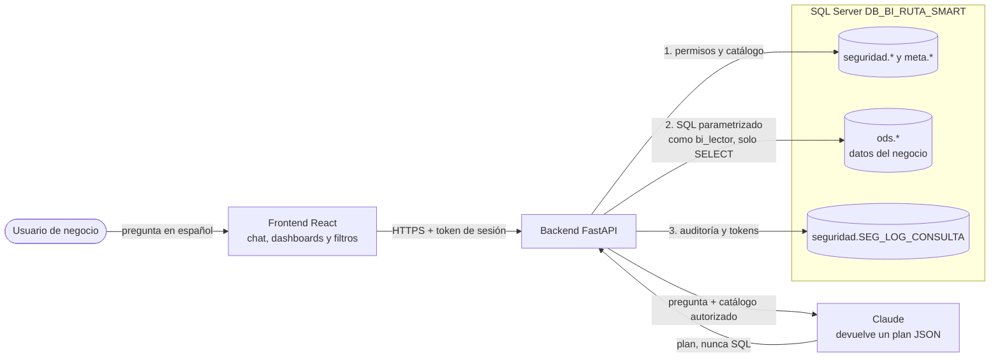

# RootSmart

**Proyecto Capstone PTY4614 · Ingeniería en Informática · Duoc UC · Grupo 5**

> Pregúntale a los datos mediante un chat y recibe un dashboard listo, sin SQL y sin riesgos.

## Descripción

**Qué hace.** RootSmart es una plataforma de inteligencia de negocios en la que una persona escribe una pregunta en español, por ejemplo «monto pagado por región en abril», y recibe un dashboard con indicadores, gráficos, filtros y una proyección de los próximos meses. Los datos se calculan sobre SQL Server.

**A quién va dirigido.** A las áreas de negocio de una aseguradora o corredora (Siniestros, Finanzas, Seguros y Cobranza) que necesitan analizar sus datos pero no saben SQL ni Power BI y no cuentan con un equipo de BI grande.

**Qué problema resuelve.** Hoy cada reporte se le pide al equipo técnico y espera su turno, y cada cambio reinicia el proceso. Conectar un chatbot directo a la base resolvería la espera, pero la IA podría inventar SQL o mostrar datos que el usuario no debe ver. RootSmart responde en minutos **sin entregarle a la IA el control de los datos**: la IA solo propone un plan, el backend lo valida contra un catálogo autorizado y los permisos del usuario, y arma un SQL parametrizado de solo lectura.

El caso de estudio usa **datos sintéticos** del negocio asegurador (más de 105 mil registros entre 2024 y 2026): 5.000 clientes, 12.000 ítems asegurados, 13.200 movimientos de prima, 71.990 cuotas y 8.000 siniestros.

## Tecnologías

| Capa | Tecnología |
|---|---|
| Frontend | React 19, Vite, React Router, Recharts, Lucide |
| Backend | Python 3.13, FastAPI, Pydantic, pyodbc |
| Inteligencia artificial | Anthropic Claude (`claude-haiku-5-5`) con salida estructurada |
| Base de datos | Microsoft SQL Server 2022 (`DB_BI_RUTA_SMART`: esquemas `ods`, `meta`, `seguridad`) |
| Contenedores | Docker y Docker Compose (SQL Server, backend y frontend con nginx) |
| Nube | Railway (despliegue del backend con su `Dockerfile`) |
| Pruebas | pytest y httpx (60 pruebas unitarias, de integración, de seguridad y de rendimiento) |
| Gestión | Jira (backlog y sprints) y GitHub (ramas y pull requests) |

## Arquitectura



Flujo de una consulta:

1. El usuario inicia sesión. La contraseña se verifica contra un hash PBKDF2-SHA256 y el backend entrega un token firmado válido por 8 horas.
2. Escribe una pregunta. Si pide escribir o borrar datos, se bloquea antes de llegar a la IA.
3. Claude traduce la pregunta a un **plan JSON** cuyos valores posibles salen del catálogo. La IA nunca escribe ni ejecuta SQL.
4. El backend valida el plan: métrica, agrupación, filtros, período y **permiso del usuario sobre el área**.
5. El backend arma el SQL solo con fragmentos del catálogo y valores como parámetros, y lo ejecuta como `bi_lector`, que solo puede leer.
6. Cada consulta queda auditada (usuario, pregunta, plan, SQL y tokens) y el frontend muestra el dashboard. Cambiar un filtro recalcula sin volver a usar la IA.

Más detalle en el [Documento de diseño y gestión ágil](seccion/grupo5/Fase%202/Evidencias%20Proyecto/Evidencias%20de%20documentaci%C3%B3n/RootSmart_Documento_Diseno_y_Gestion_Agil.docx), la [Especificación funcional](seccion/grupo5/Fase%202/Evidencias%20Proyecto/Evidencias%20de%20documentaci%C3%B3n/RootSmart_Especificacion_Funcional.docx) y el [Modelo de datos](seccion/grupo5/Fase%202/Evidencias%20Proyecto/Evidencias%20de%20documentaci%C3%B3n/MODELO_DATOS.md).

## Cómo ejecutar el proyecto localmente

El código está en [`seccion/grupo5/Fase 2/Evidencias Proyecto/Evidencias de sistema/RootSmart`](seccion/grupo5/Fase%202/Evidencias%20Proyecto/Evidencias%20de%20sistema/RootSmart).

### Opción A: Docker Compose (recomendada)

Requisitos: Docker Desktop y una API key de Anthropic.

```bash
cd "seccion/grupo5/Fase 2/Evidencias Proyecto/Evidencias de sistema/RootSmart"
cp .env.example .env        # en Windows: copy .env.example .env
# editar .env: ANTHROPIC_API_KEY, MSSQL_SA_PASSWORD y SESSION_SECRET
docker compose up --build
```

| Servicio | Dirección | Qué hace |
|---|---|---|
| `frontend` | http://localhost:8080 | Aplicación web (React compilado, servido con nginx) |
| `backend` | http://localhost:8000/docs | API FastAPI con su documentación interactiva |
| `db` | `localhost,1433` | SQL Server 2022 |
| `db-init` | — | Crea la base la primera vez: ejecuta en orden los scripts de `Levantamiento Database` y de `backend/db/sqlserver`, y termina |

Usuarios de demostración (clave `1234`): `USR_SIN` (Siniestros), `USR_FIN` (Finanzas y Cobranza), `USR_SEG` (Seguros) y `USR_ADMIN` (todas las áreas). Para partir de cero: `docker compose down -v`.

### Opción B: sin Docker

Requisitos: SQL Server, ODBC Driver 18 for SQL Server, Python 3.13 y Node.js 22.

1. **Base de datos:** ejecutar en orden los scripts de [`Levantamiento Database`](seccion/grupo5/Fase%202/Evidencias%20Proyecto/Evidencias%20de%20sistema/Levantamiento%20Database) (`00`–`13`, `15`–`18` y `20`) y luego los de `RootSmart/backend/db/sqlserver` (`15`–`17` y `22`–`26`).
2. **Backend:**
   ```bash
   cd RootSmart/backend
   python -m venv .venv
   .venv\Scripts\activate          # Linux/Mac: source .venv/bin/activate
   pip install -r requirements.txt
   copy .env.example .env          # completar ANTHROPIC_API_KEY, DB_SERVER y SESSION_SECRET
   uvicorn app.main:app --reload --port 8000
   ```
3. **Frontend:**
   ```bash
   cd RootSmart/frontend
   npm install
   echo VITE_API_URL=http://localhost:8000 > .env.local
   npm run dev                     # http://localhost:5173
   ```

### Pruebas

```bash
cd RootSmart/backend
pip install -r requirements-dev.txt
pytest -v
```

Las pruebas no necesitan SQL Server ni la API de Anthropic: la base y la IA se reemplazan por dobles de prueba. Cubren la validación del plan, el armado del SQL, contraseñas, sesiones, bloqueo de escrituras, inyección SQL, permisos por área, el flujo completo de la API y tiempos de respuesta.

## Equipo y roles

| Integrante | Rol Scrum | Responsabilidades principales |
|---|---|---|
| Ignacio Carrasco | Product Owner | Prioriza el backlog en Jira, define el alcance, requisitos y trazabilidad, acepta lo entregado y consolida las evidencias |
| Felipe Piñera | Scrum Master | Facilita planning, daily, review y retrospectiva; lidera el modelo de datos, las reglas de negocio y las validaciones SQL |
| Valentín Navarro | Developer | Frontend, API, integración con IA, seguridad y despliegue |

Los tres forman el equipo de desarrollo: participan en desarrollo y revisión y muestran el incremento en cada sprint review.

## Metodología de trabajo

El equipo trabajó con **Scrum**:

- **7 sprints de 2 semanas**, entre agosto y noviembre de 2026.
- **Product Backlog en Jira**: 9 épicas y 19 historias de usuario (claves `BIC-10` a `BIC-44`), priorizadas por el Product Owner.
- Ceremonias: sprint planning, daily, sprint review con demostración del incremento y retrospectiva.
- Integración en GitHub mediante ramas y pull requests revisados por otro integrante.
- Definition of Done, sprint backlogs, retrospectivas y plan de pruebas en el [Documento de diseño y gestión ágil](seccion/grupo5/Fase%202/Evidencias%20Proyecto/Evidencias%20de%20documentaci%C3%B3n/RootSmart_Documento_Diseno_y_Gestion_Agil.docx).

## Estructura del repositorio

```
seccion/grupo5/
├── Fase 1/                     Definición del proyecto
│   ├── Evidencias Grupales/    Guía 1.5, formativa, presentación y planilla
│   └── Evidencias individuales/
├── Fase 2/                     Desarrollo del proyecto
│   ├── Evidencias Grupales/    Guías 2.4 y 2.6 y planillas
│   ├── Evidencias individuales/
│   └── Evidencias Proyecto/
│       ├── Presentación Proyecto.pptx
│       ├── Evidencias de documentación/   Especificación, modelo de datos, diseño y gestión ágil
│       └── Evidencias de sistema/
│           ├── Levantamiento Database/    Scripts SQL 00–21
│           └── RootSmart/                 backend, frontend, docker-compose
└── Fase 3/                     Presentación final
    ├── Evidencias Grupales/    Presentación final, video demo, autoevaluación y planilla
    └── Evidencias individuales/
```
